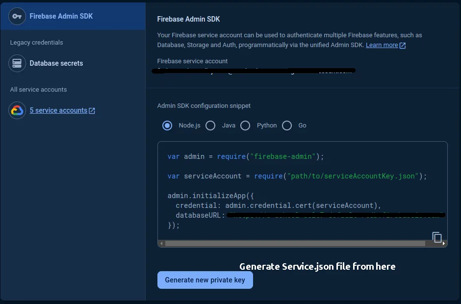

# Firebase and notifications

<AdminPath path="System › Settings › Notifications" />.

eDrama uses **one Firebase project** for the app, the Admin Panel and the Creator Portal: viewers and creators sign in with Firebase Authentication, and pushes go out through Firebase Cloud Messaging.

:::tip Create the Firebase project first
Creating the project, adding the Android and iOS apps and running `flutterfire configure` are covered in the [Mobile App › Firebase](/mobile-app/firebase/) guide. Use the same project here.
:::

## Firebase keys

Click **Add keys** (or **Replace keys**) on the **Firebase** card.

| Field | Where to find it |
|---|---|
| **Project ID** | Firebase console › Project settings › **General** › Project ID |
| **Service account JSON** | Firebase console › Project settings › **Service accounts** › **Generate new private key**. Upload the downloaded JSON file. |
| **Web API key** | Needed for the Creator Portal's sign-in. Project settings › General › **Your apps**: add a **Web app** if you have none, and copy its `apiKey`. |
| **Auth domain** | Needed for the Creator Portal's sign-in, such as `your-project.firebaseapp.com` (the web app's `authDomain`). |

Keys are stored encrypted and never shown again. Leave a field empty to keep its current value. Press **Test connection** after saving.

## Push limits

| Field | What it does |
|---|---|
| **Maximum per viewer per day** | Pushes above this wait for the next day. The in-app inbox still gets every message. |
| **Quiet hours start** / **Quiet hours end** | In each viewer's own time. Pushes wait until quiet hours end. |

The app reads these at its next start. Pushes need the [background jobs](../background-jobs.md) running.

## System alerts

Who hears within minutes when a background job or scheduled task fails.

- **Alert emails**: one or more addresses, separated by commas. Members who can edit Settings also get a bell notification in the Admin Panel.
- **Slack webhook URL** (optional): an incoming webhook for your team's alerts channel (Slack › Apps › Incoming Webhooks).
