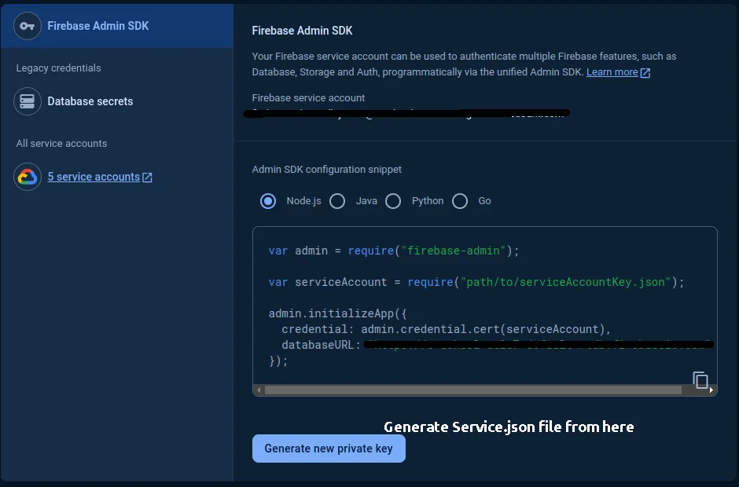

# Firebase and notifications

<AdminPath path="System › Settings › Notifications" />.

eDrama uses **one Firebase project** for the app, the Admin Panel and the Creator Portal: viewers and creators sign in with Firebase Authentication, and pushes go out through Firebase Cloud Messaging. Your server uses the same project to check every viewer's sign-in token, send pushes, and sign creators in to the portal.

:::tip Create the Firebase project first
Creating the project, adding the Android and iOS apps and running `flutterfire configure` are covered in the [Mobile App › Firebase](/mobile-app/firebase/) guide. Use the same project here.
:::

## Firebase keys

Click **Add keys** (or **Replace keys**) on the **Firebase** card.

| Field | Where to find it |
|---|---|
| **Project ID** | [Firebase console](https://console.firebase.google.com/) › your project › Project settings › **General** › Project ID |
| **Service account JSON** | Firebase console › Project settings › **Service accounts** › **Generate new private key**. Open the downloaded JSON file and paste its whole contents. |
| **Web API key** | Optional, but needed for the Creator Portal's sign-in. Project settings › General › **Your apps**: add a **Web app** if you have none, and copy its `apiKey` (it starts with `AIza`). |
| **Auth domain** | Optional, but needed for the Creator Portal's sign-in, such as `your-project.firebaseapp.com` (the web app's `authDomain`). |

Press **Save keys**. Secrets are stored encrypted and never shown again; leave one empty to keep its current value. Then press **Test connection**: it checks the key with Firebase Cloud Messaging without sending anything. Keys already set in the server's `.env` show as coming from the server's environment, and saving a value here replaces them.

Without these keys, inbox notifications are still saved but pushes are skipped, and Push shows *Pushes aren't set up yet*.

### Allow the Creator Portal's domain

Creators sign in from the browser at your domain, so it must be allowed: in the Firebase console, **Authentication › Settings › Authorized domains** › add your Admin Panel's domain. Otherwise creators see *This site isn't allowed to sign in with Firebase yet*.

Enable the sign-in providers creators use (Google, Email/Password, Phone) under **Authentication › Sign-in method**; viewers also need **Anonymous** (guests) and **Apple**.

### App Check

App Check proves requests come from your genuine app on a real device. It's set in the server's [`.env`](../environment.md):

| `EDRAMA_APP_CHECK` | Behaviour |
|---|---|
| `off` (default) | Not checked. |
| `monitor` | Checked and logged, nothing refused. Start here. |
| `enforce` | Requests without a valid token are refused. |

Limit it to your apps with `EDRAMA_APP_CHECK_APP_IDS` (comma-separated Firebase app IDs). An outage on your side is never held against viewers.

:::tip Viewers signed out right after signing in?
Your server's clock may be off. Keep it synced: the allowance `EDRAMA_FIREBASE_CLOCK_LEEWAY` (60 seconds) only covers small drift.
:::

## Push limits

| Field | What it does |
|---|---|
| **Maximum per viewer per day** | 3 to start, up to 20. Pushes above this wait for the next day. The in-app inbox still gets every message. |
| **Quiet hours start** / **Quiet hours end** | 23:00 to 08:00 to start, in each viewer's own time. Pushes wait until quiet hours end. |

The app reads these at its next start. Pushes need the [background jobs](../background-jobs.md) running.

## Notification messages

The wording of the automatic notifications, in each app language. Press **Edit** on one to change its lines per language, then **Save messages**. A line left empty uses the language file's text, and **Restore default wording** puts every language back.

| Message | When it's sent | Placeholders you can use |
|---|---|---|
| **New episodes (drop alerts)** | To a series' followers when episodes come out; several in a day merge into one. Lines for one episode, two episodes, a run, many episodes, and the text under it. | `{title}` `{number}` `{episode}` `{first}` `{second}` `{last}` `{count}` |
| **Reply to a comment** | When someone replies to a viewer's comment. | `{name}` |
| **New series from a followed creator** | When a creator a viewer follows publishes a new series. | `{creator}` `{title}` |
| **VIP renewal reminder** | A day before each VIP charge. Always sent; viewers can't switch it off. | `{plan}` `{date}` `{period}` `{amount}` `{store}` |
| **Several notifications in one** | When notifications are grouped while quiet hours or the daily limit hold them. | `{count}` |

The `{placeholders}` are filled in when the message is sent. Titles are limited to 120 characters and body lines to 240.

## System alerts

Who hears within minutes when a background job or scheduled task fails.

Fill in at least one of the two:

- **Alert emails**: one or more addresses, separated by commas. Members who can edit Settings also get a bell notification in the Admin Panel. Emails need [SMTP](./email.md).
- **Slack webhook URL**: an incoming webhook for your team's alerts channel, starting with `https://hooks.slack.com/services/`. To get one: [api.slack.com/apps](https://api.slack.com/apps) › **Create New App** › **Incoming Webhooks** › **Add New Webhook to Workspace** › pick the channel › copy the URL.

**Test connection** on this card sends a test alert. Alerts are throttled to one per job per 15 minutes, and the license check also alerts here if your purchase code is refused.
